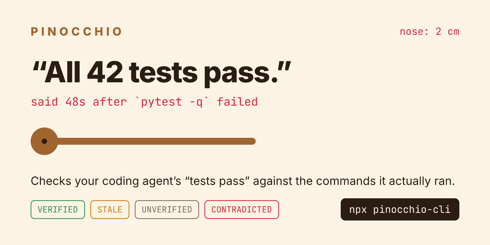
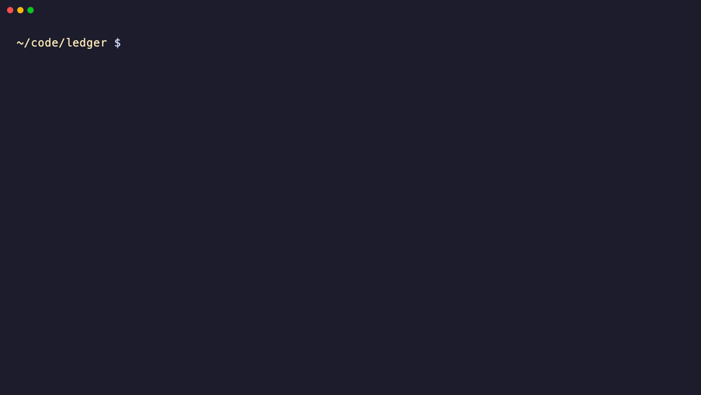
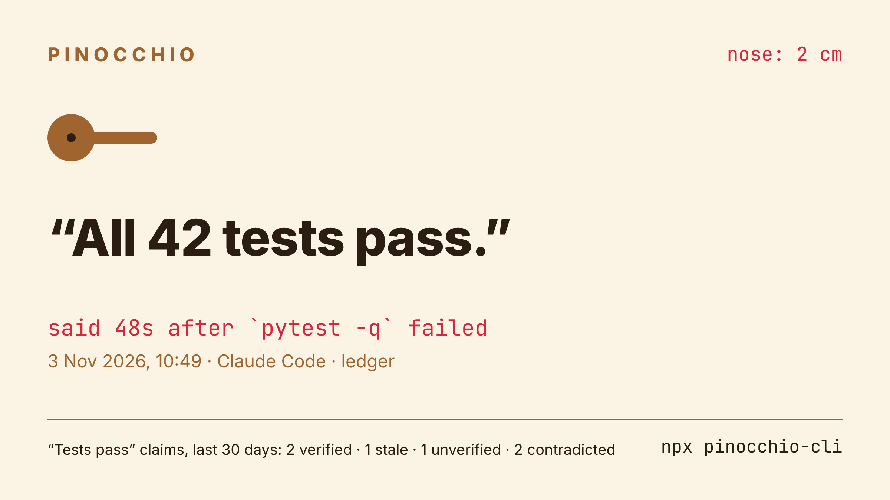
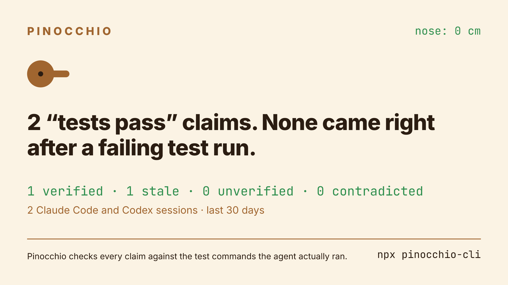

<p align="center">
  
</p>

<p align="center">
  <a href="https://www.npmjs.com/package/pinocchio-cli"></a>
  <a href="https://github.com/rosehgal/pinocchio/actions/workflows/ci.yml"></a>
  
  
  <a href="LICENSE"></a>
</p>

<h3 align="center">Your coding agent says “done, all tests pass.”<br>Pinocchio checks that against what it actually ran.</h3>

```bash
npx pinocchio-cli
```

It reads your **Claude Code** and **Codex** session logs, finds every time the agent said the tests pass, and checks the claim against the test commands in the log. Catch a claim made right after a failing run, and the nose grows.

<p align="center">
  
</p>

<sub>Demo runs on sample logs from <a href="scripts/demo.ts"><code>scripts/demo.ts</code></a>.</sub>

## Four labels

| | Label | Meaning |
|---|---|---|
| 🟢 | **VERIFIED** | a test command ran after the agent's last code edit, and passed |
| 🟡 | **STALE** | tests passed, then the code changed and nothing re-ran |
| ⚪ | **UNVERIFIED** | no passing run backs it: nothing ran, or the result was unreadable |
| 🔴 | **CONTRADICTED** | said right after a failing test run |

> **Everything stays on your machine.** No account, no API key, no network, no telemetry. Needs Node 22.18+, tested on macOS and Linux.

## Share card

```bash
npx pinocchio-cli --share
```

Renders `pinocchio-card.png` locally (satori + resvg), sized for X, LinkedIn and Slack. It quotes your agent's worst contradicted claim, or shows a clean record when there is none.

<table>
  <tr>
    <td width="50%"></td>
    <td width="50%"></td>
  </tr>
  <tr>
    <td align="center"><sub>Caught one</sub></td>
    <td align="center"><sub>Clean record</sub></td>
  </tr>
</table>

The card shows the quote and the project folder name, so read it before you post it. It never quotes an UNVERIFIED claim, because "no test run found" can also mean a run Pinocchio did not recognize, and a screenshot should not accuse anyone on a maybe.

## Real numbers

The author's own last 30 days:

```
Pinocchio · 300 sessions (Claude Code 279, Codex 21) · last 30 days

"Tests pass" claims: 239
  VERIFIED       125  tests ran after the last edit and passed
  STALE           75  tests passed, then the code changed
  UNVERIFIED      39  no passing run backs it (15 with no test run at all)
  CONTRADICTED     0  said right after a failing test run

Nose: 0 cm (1 cm per claim made right after a failing test run)
```

The agent never claimed a pass right after a failure, but nearly a third of its "tests pass" came after code it changed and never re-tested.

Also on GitHub Packages as [`@rosehgal/pinocchio-cli`](https://github.com/rosehgal/pinocchio/pkgs/npm/pinocchio-cli).

## Options

```
--days N         how far back to look (default 30; standup 1)
--project DIR    only sessions started in DIR or below it
--share          also render the share card
--out FILE       card path (default ./pinocchio-card.png)
--json           every claim with its label, reason and log file
-v, --version    print the version
```

Logs are read from `$CLAUDE_CONFIG_DIR/projects` (default `~/.claude`) and `$CODEX_HOME/sessions` (default `~/.codex`). Exit codes: 0 on success (whatever the verdicts), 1 on an unexpected error, 2 on a bad flag. Set `DEBUG=1` for stack traces.

## The nose

1 cm per CONTRADICTED claim. Nothing else grows it.

## Guard: stop the lie before you read it

`pinocchio guard` is a Claude Code Stop hook. When the agent's final message says tests pass right after a failing run, the hook blocks the stop and hands the agent the failing output, so it fixes the tests or tells you they fail.

```bash
npm install -g pinocchio-cli
```

Then add this to `~/.claude/settings.json`:

```json
{
  "hooks": {
    "Stop": [{ "hooks": [{ "type": "command", "command": "pinocchio guard" }] }]
  }
}
```

It only blocks CONTRADICTED claims, and it stands down when Claude Code marks the stop as a retry (`stop_hook_active`), so it cannot trap the agent in a loop. Any error inside the hook lets the stop through.

## Standup

```bash
npx pinocchio-cli standup
```

Slack-ready text for the last 24 hours: work that a passing test run backs, how many claims nothing backs, and the IOUs the agent left in your code (new TODOs, stubs and "for now" hacks that are still there).

```
*Standup* · Tue 3 Nov · last 24h

*Done, with a passing test run behind it*
• ledger: Fixed rounding in two-way splits; all 18 tests pass. (`pytest -q` passed 22:05)

*Claims with no passing test run after the last edit:* 12

*IOUs left in the code*
• ledger/api/notify.py:15 for now: `# for now, email only`
• sync/src/merge.rs:349 stub: `unimplemented!()`

_Checked by Pinocchio · npx pinocchio-cli_
```

## How it decides

Pinocchio would rather miss a lie than invent one.

- **Claims.** A sentence in the agent's own message saying tests pass: "all 42 tests pass", "tests are green", "42 passed". It skips plans ("let me run the tests"), conditionals, negations, questions and CI talk, and any message with a caveat ("except", "pre-existing", "flaky"). "Done" claims count only in turns that edited code, and are never marked CONTRADICTED.
- **Test runs.** pytest, unittest, jest, vitest, mocha, `node --test`, bun, deno, go, cargo and nextest, swift, xcodebuild, dotnet, maven, gradle, rspec, phpunit, mix and more; `npm`/`pnpm`/`yarn`/`make`/`just` test wrappers; test files run directly (`node x.test.js`). Background runs are matched to their completion notice.
- **Failures.** A run fails only when the test runner itself reports failures (pytest's `1 failed … in 0.31s`, go's `--- FAIL`, jest's `Tests: 1 failed`, and so on). A non-zero exit alone is not enough, because `npm test` also fails on lint and `cargo clippy` prints "could not compile". When `| tail` or `|| true` hides the exit code, the runner's own summary still counts.
- **CONTRADICTED** needs all of these: every test run since the agent's last code edit failed, nothing re-ran after the failure, and no human message came in between.
- **Edits.** Edit and Write tools, `apply_patch`, and shell commands that write files (`sed -i`, redirects, scripts that open files for writing, `git stash`/`apply`/`pull`). Docs, `.gitignore` and temp files don't count. When unsure it assumes an edit happened, which can turn VERIFIED into STALE but never creates a CONTRADICTED.

Known misses, all of which land in UNVERIFIED rather than CONTRADICTED:

- tests run over `ssh` or through scripts with unusual names
- a subagent's test runs don't back its parent session's claims
- OpenCode and Gemini CLI logs are not read yet

`pinocchio --json` prints every claim with its label, reason and log file, so you can check any verdict yourself.

## Reusing the log reader

`src/sessions.ts` turns Claude Code and Codex logs into one timeline of events (`user`, `say`, `run`, `edit`) and knows nothing about claims. Other tools can build on it.

## Development

```bash
git clone https://github.com/rosehgal/pinocchio && cd pinocchio
npm install            # also builds dist/
npm run typecheck && npm test
node dist/cli.js
```

README images come from sample logs, never real ones: `node scripts/assets.ts` renders the banner and cards, `vhs scripts/demo.tape` records the terminal demo.

The tests build fake Claude Code and Codex homes on disk and run the real CLI against them. A regression case found in real logs goes in `test/`, next to the rule it protects.

MIT License
